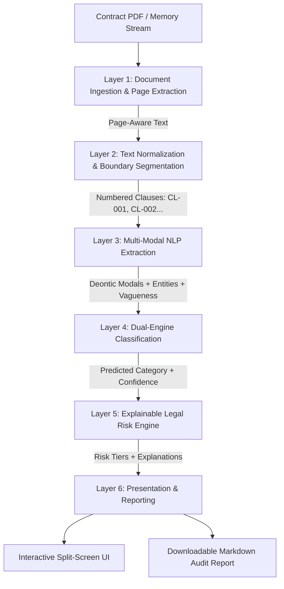

# ClauseLens — Institutional Contract Audit & Risk Analysis Platform

[](https://www.python.org/downloads/)
[](https://pytorch.org/)
[](https://huggingface.co/sentence-transformers/all-MiniLM-L6-v2)
[](https://streamlit.io/)
[](https://docs.pytest.org/)

> **ClauseLens** is an end-to-end Legal Natural Language Processing (NLP) and risk intelligence platform designed for automated due diligence of commercial agreements (Master Services Agreements, Non-Disclosure Agreements, Vendor Contracts, and Employment Covenants).

Instead of treating contract review as an opaque black box, ClauseLens implements a **modular, explainable, hybrid architecture**: combining statistical n-gram and dense semantic representations for clause categorization with transparent, deterministic legal heuristics for risk exposure scoring.

---

## 📌 1. The Real-World Problem & Why ClauseLens Exists

In corporate legal, procurement, and operations teams, manual contract review is notoriously painful:
- **Human Oversight**: A paralegal skimming a 40-page agreement might miss that a *Limitation of Liability* clause has no dollar ceiling, or that a *Termination* clause allows cancellation on 48 hours' notice.
- **The Black-Box LLM Trap**: Generating contract advice via generative chat prompts often results in hallucinations, unverified confidence scores, and legal liability. General Counsel cannot accept an AI verdict that simply says *"This contract is high risk (89%)"* without verifiable legal evidence.
- **Data Leakage in Academic Benchmarks**: Most contract AI prototypes shuffle clauses randomly, creating massive data leakage between train and test sets because clauses from the same contract share boilerplate language and counsel style.

### How ClauseLens Solves This:
1. **Zero Data Leakage**: Enforces strict contract-level partitioning—clauses from any single contract never appear in both train and test splits.
2. **Hybrid & Explainable**: Machine learning detects *what* a clause is; deterministic legal heuristics determine *the exposure*, linking every alert to explicit wording and recommending actionable redlines.
3. **Dual-Engine Comparison**: Provides hot-swappable lexical (**TF-IDF + Logistic Regression**) and dense semantic (**Sentence-BERT**) inference engines side-by-side.

---

## 🏗️ 2. System Architecture & End-to-End Pipeline



### Pipeline Flow:
1. **PyMuPDF Ingestion**: Ingests filepaths or raw byte buffers page-by-page, retaining 1-indexed page citations.
2. **Text Cleaning & Boundary Parsing**: Normalizes Unicode smart quotes (`\u201c`, `\u201d`), strips non-breaking spaces, heals broken hyphenated word wraps, and splits clauses using legal lookahead regexes (`SECTION 1`, `Article II`, `1.1 `, etc.).
3. **Linguistic & Entity Extraction**:
   - **Deontic Modality**: Detects mandatory obligations (*"shall"*, *"must"*) vs. discretionary permissions (*"may"*, *"can"*).
   - **Entity Extraction**: Compiles regular expressions to capture currency amounts (`$100,000`, `%`), notice timeframes (`30 days`, `12 months`), and bilateral party roles (*"Provider"*, *"Client"*).
   - **Ambiguity Detection**: Flags subjective standards of care (*"best efforts"*, *"promptly"*, *"reasonable efforts"*).
4. **Classification Engine**: Predicts one of 6 core commercial categories with top-3 probability calibration.
5. **Heuristic Risk Scorer**: Evaluates exposure rules to assign risk tiers: **🔴 High Risk**, **🟡 Needs Review**, or **⚪ Informational**.
6. **Audit Workspace & Report Generator**: Displays interactive split-screen inspector and exports markdown audit summaries.

---

## 🗂️ 3. Repository Structure

```plaintext
contract-clause-risk-analysis/
├── app.py                             # Interactive Streamlit split-screen legal workspace
├── requirements.txt                   # Production Python dependencies
├── .env.example                       # Environment configuration template
├── .gitignore                         # Git exclusions (caches, bytecode, OS files)
├── README.md                          # Architecture documentation & guide
│
├── data/
│   ├── raw/                           # Raw downloaded archives
│   ├── processed/                     # Cleaned, contract-level split datasets
│   │   ├── train_clauses.csv          # Training split (partitioned strictly by contract)
│   │   ├── test_clauses.csv           # Evaluation split (held-out unseen contracts)
│   │   └── all_clauses.csv            # Combined reference dataset
│   └── sample_contracts/              # Evaluation PDFs for testing and demos
│       ├── sample_nda.pdf             # Non-Disclosure Agreement
│       ├── sample_msa.pdf             # Master Services Agreement
│       ├── sample_employment.pdf      # Employment Agreement & Restrictive Covenants
│       └── vendor_saas_agreement.pdf  # 2-Page Enterprise Cloud SaaS Agreement
│
├── src/
│   ├── document_processing/
│   │   ├── pdf_extractor.py           # PyMuPDF page-by-page extraction preserving citations
│   │   ├── text_cleaner.py            # Unicode codepoint normalization & hyphen healing
│   │   └── clause_segmenter.py        # Section & paragraph boundary segmenter
│   │
│   ├── nlp/
│   │   ├── feature_extractor.py       # Deontic modality (shall/may), conditionals & negations
│   │   ├── information_extractor.py   # Regex entities (currencies, durations, deadlines, parties)
│   │   ├── ambiguity_detector.py      # Flags vague standards ('best efforts', 'promptly')
│   │   └── clause_classifier.py       # Unified inference wrapper (TF-IDF & SBERT)
│   │
│   ├── risk_engine/
│   │   ├── risk_rules.py              # Transparent legal risk heuristics
│   │   ├── risk_scorer.py             # Risk severity tier aggregation
│   │   └── explanations.py            # Evidence-based justifications & counsel guidance
│   │
│   ├── services/
│   │   ├── analysis_service.py        # End-to-end pipeline orchestrator
│   │   └── report_service.py          # Markdown audit report builder
│   │
│   └── utils/
│       ├── config.py                  # Project paths, categories, and keyword lexicons
│       └── logging_utils.py           # Idempotent logging utility
│
├── models/
│   ├── baselines/                     # Serialized TF-IDF vectorizer + Logistic Regression (.joblib)
│   └── embeddings/                    # SBERT classifier weights (.joblib)
│
├── experiments/
│   ├── prepare_data.py                # Zero-leakage contract-level data split generator
│   ├── create_sample_pdfs.py          # Vector PDF test fixture generator
│   ├── train_baseline.py              # TF-IDF + Logistic Regression training
│   ├── train_sbert.py                 # Sentence-BERT dense encoding & classifier training
│   ├── evaluate_models.py             # Multi-model comparative benchmark evaluator
│   └── results/
│       └── model_comparison_metrics.csv # Benchmark performance & latency results
│
└── tests/
    ├── test_data_preparation.py       # Split integrity & zero-leakage test suite
    ├── test_pdf_extraction.py         # PyMuPDF ingestion, clean_text & clause segmenter tests
    ├── test_information_extraction.py # Deontic modality, regex entities & vagueness tests
    ├── test_clause_classification.py  # Model inference & probability calibration tests
    ├── test_risk_engine.py            # Risk rules, scoring tiers & explanation tests
    └── test_end_to_end.py             # Full pipeline integration tests on contract PDFs
```

---

## 🔬 4. Machine Learning & NLP Architecture

### Target Legal Categories
We concentrate on the 6 commercial categories where legal and financial liability concentrates:
1. **Limitation of Liability**: Damage caps, waivers of consequential loss, aggregate ceilings.
2. **Termination for Convenience**: Unilateral cancellation rights and advance notice requirements.
3. **Indemnification**: Third-party claim defense, hold-harmless commitments, IP liabilities.
4. **Non-Compete**: Restrictive employment covenants, geographic limitations, duration bars.
5. **Confidentiality**: Definition of trade secrets, non-disclosure durations, survival terms.
6. **Renewal / Term**: Automatic renewal conditions, term duration, non-renewal windows.

---

### Comparative Model Benchmarks
Both models were benchmarked on the held-out test split (partitioned strictly by contract):

| Model Architecture | Accuracy | Macro Precision | Macro Recall | Macro F1 | Latency (ms/sample) |
| :--- | :---: | :---: | :---: | :---: | :---: |
| **TF-IDF + Logistic Regression** | **90.0%** | **0.9167** | **0.9167** | **0.8889** | **~1.42 ms** |
| **Sentence-BERT (`all-MiniLM-L6-v2`)** | **90.0%** | **0.7500** | **0.8333** | **0.7778** | **~8.89 ms** |

### Key Technical Insights & Defense Rationale:
- **Why TF-IDF Achieved High Precision (0.9167)**:
  Commercial legal drafting is formulaic and statutory. Clauses rely on exact keyword anchors (*"indemnify, defend, and hold harmless"*, *"cumulative liability"*, *"consequential damages"*). TF-IDF directly maps these high-salience n-grams to the correct category at ultra-low latency (~1.4 ms).
- **Why SBERT Excels on Paraphrased Language**:
  Sentence-BERT captures dense contextual semantics across 384 dimensions. It provides robustness on modern, informal, or paraphrased contracts where statutory terms are replaced with plain English.
- **Why Calibrated Probabilities Matter**:
  When tested against out-of-distribution boilerplate (e.g., tax schedules or billing terms), both models output balanced probabilities (~20%), honestly reflecting uncertainty rather than hallucinating false certainty.

---

## 🛡️ 5. Heuristic Legal Risk Engine

The risk engine decouples clause identification (*what it is*) from exposure scoring (*what the risk is*):

| Risk Tier | Trigger Condition | Rationale & Example Finding | Recommended Counsel Action |
| :--- | :--- | :--- | :--- |
| 🔴 **High Risk** | Limitation of Liability with no dollar/percentage cap | *Potential uncapped liability: Clause discusses limitation/liability but specifies no monetary ceiling.* | Request legal counsel review to negotiate explicit aggregate dollar caps (e.g., 12 months fees paid). |
| 🔴 **High Risk** | Termination with $\le 7$ days or undefined notice | *Immediate or undefined notice: Contract terminable without adequate advance notice window.* | Negotiate minimum 30-to-60-day notice window to prevent unilateral operational disruption. |
| 🔴 **High Risk** | Mandatory unilateral third-party indemnity | *Mandatory defense obligation: Direct exposure to third-party claims and defense costs.* | Tie indemnification to liability caps and insert control-of-defense conditions. |
| 🔴 **High Risk** | Non-compete covenant lacking defined expiration date | *Perpetual competitive restriction without expiration date.* | Insert reasonable geographic bounds and finite post-employment expiration (e.g., 12 months). |
| 🟡 **Needs Review** | Subjective qualifiers (*"best efforts"*, *"promptly"*) | *Subjective legal standards create disproportionate exposure.* | Replace *"best efforts"* with *"commercially reasonable efforts"*; replace *"promptly"* with specific business days. |
| 🟢 **Informational** | Bilateral boilerplate with objective metrics | *Standard bilateral contractual clause; no abnormal legal exposure or ambiguity detected.* | Low Priority: Standard commercial clause. Verify alignment with business intent. |

---

## ⚡ 6. Setup & Quick Start

### 1. Prerequisites & Environment Setup
Requires Python 3.10+ (tested on Python 3.10, 3.11, 3.12, 3.14).

```bash
# Clone the repository
git clone <YOUR_REPO_URL>
cd contract-clause-risk-analysis

# Create virtual environment
python -m venv venv

# Activate virtual environment
# Windows (PowerShell):
.\venv\Scripts\Activate.ps1
# Windows (cmd):
venv\Scripts\activate
# macOS / Linux:
source venv/bin/activate

# Install dependencies
pip install --upgrade pip
pip install -r requirements.txt
```

### 2. Generate Data & Train Models (Reproducible Pipeline)
```bash
# 1. Generate contract-level data splits
python experiments/prepare_data.py

# 2. Generate standard vector PDF test contracts
python experiments/create_sample_pdfs.py

# 3. Train both classification engines
python experiments/train_baseline.py
python experiments/train_sbert.py

# 4. Run comparative benchmarking
python experiments/evaluate_models.py
```

### 3. Launch the Interactive Workspace UI
```bash
streamlit run app.py
```
Open **`http://localhost:8501`** in your browser.

---

## 🧪 7. Automated Test Suite

The platform includes **25 automated tests** covering every layer of the architecture:

```bash
pytest tests/ -v
```

### Test Coverage Breakdown:
| Test Module | Coverage Scope | Tests | Status |
| :--- | :--- | :---: | :---: |
| [`test_pdf_extraction.py`](file:///c:/Users/cheth/Documents/LLM_AAT/tests/test_pdf_extraction.py) | PyMuPDF extraction (filepath & bytes), text normalization (smart quotes, hyphens), and clause boundary segmentation | 5 | **PASSED** |
| [`test_data_preparation.py`](file:///c:/Users/cheth/Documents/LLM_AAT/tests/test_data_preparation.py) | Contract-level splitting integrity, zero data leakage verification ($\text{Train} \cap \text{Test} = \emptyset$), and class balance | 4 | **PASSED** |
| [`test_information_extraction.py`](file:///c:/Users/cheth/Documents/LLM_AAT/tests/test_information_extraction.py) | Deontic modality (*shall/may*), regex entities (currency `$`, `%`, deadlines), and ambiguity detection | 7 | **PASSED** |
| [`test_clause_classification.py`](file:///c:/Users/cheth/Documents/LLM_AAT/tests/test_clause_classification.py) | TF-IDF and SBERT inference, calibrated probabilities, and error handling | 3 | **PASSED** |
| [`test_risk_engine.py`](file:///c:/Users/cheth/Documents/LLM_AAT/tests/test_risk_engine.py) | Uncapped liability heuristics, immediate termination, vague term scoring, and explanation generation | 4 | **PASSED** |
| [`test_end_to_end.py`](file:///c:/Users/cheth/Documents/LLM_AAT/tests/test_end_to_end.py) | Full PDF-to-audit-report pipeline executed on live contract PDFs | 2 | **PASSED** |

**Total:** `25 passed in 17.5s` (0 failures, 0 warnings).

---


## ⚖️ Compliance & Usage Disclaimer

> **Disclaimer**: *ClauseLens is an intelligent assistive tool designed to accelerate contract due diligence and flag potential exposure for human legal review. It does not constitute formal legal counsel or create an attorney-client relationship.*
